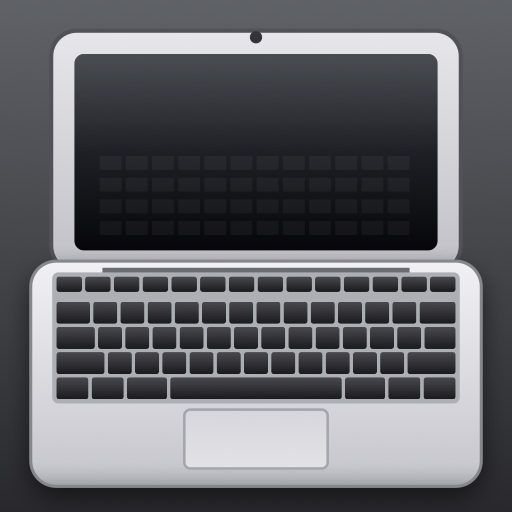

# sidecar9



Второй монитор для Mac из старого iPad на iOS 9. Apple Sidecar требует iPadOS 13, Duet и Luna давно
подняли минимум, а планшеты 2012–2015 годов лежат без дела. Здесь всё своё: сервер на Mac создаёт
виртуальный монитор и отдаёт его по Wi‑Fi, нативное приложение на планшете рисует и превращает
касания в мышь.

*English: a second display for an Apple Silicon Mac made from a 32‑bit iPad running iOS 9. Mac side
(Swift, ScreenCaptureKit, private `CGVirtualDisplay`) streams changed rectangles over TCP; iPad side is a
UIKit app built for armv7 with a modern Xcode plus the iOS 9.3 SDK, installed through a jailbreak.
Notes on jailbreaking iOS 9 in 2026 are in `docs/`.*

Проверено: iPad mini 1 (iPad2,5, iOS 9.3.5) и MacBook Pro M4 Pro, macOS 26. Результат: 1024×768,
15–20 кадров/с при движении, до 2 МБ/с по Wi‑Fi, задержка на уровне одного кадра, клики и прокрутка
с планшета.

## Как это работает

```
Mac (ScreenServe.app)                                    iPad (MacScreen.app)
CGVirtualDisplay 1024x768 ── для macOS это третий монитор
   │ ScreenCaptureKit: кадры только при изменениях
   │ сравнение плитками 32x32 → изменившиеся полосы
   │ XRGB1555 + deflate ──── TCP 8082 ─────────────────►  inflate → CGBitmapContext → CALayer
   │ ◄──────────────────── ACK на каждый кадр ──────────  (в полёте не больше одного кадра)
   │ положение мыши ────────────────────────────────────►  курсор рисует клиент
   │ ◄─────── тап, удержание, два пальца ────────────────  CGEvent: клик, drag, прокрутка, правая кнопка
```

Формат пакетов описан в шапке `server/screenserve.swift`.

## Состав

| Путь | Что это |
|---|---|
| `server/` | `screenserve.swift` + `vdisplay.m` → `ScreenServe.app`, Swift, macOS 13+ |
| `client/` | `main.m`, `Info.plist`, иконки, `build.sh` → `MacScreen.app`, Objective‑C, iOS 9.0+, armv7 |
| `scripts/` | `get-sdk.sh` и `patch-sdk.py` (SDK iOS 9.3), `ipad-ssh`/`ipad-scp` (планшет по USB), `ipad-screen` (агент), `browser-streamer.py` (запасной вариант через Safari) |
| `launchd/` | шаблон LaunchAgent для автозапуска сервера |
| `docs/jailbreak-notes.md` | джейлбрейк iOS 9 в 2026: Carbon, iocaste, Cydia из России, пакеты, освобождение системного раздела |

## Что нужно

- Mac: Xcode (Swift, ScreenCaptureKit), Homebrew, `brew install ldid libimobiledevice`,
  сертификат «Apple Development» в связке ключей (бесплатный Apple ID в Xcode достаточно).
- iPad: джейлбрейк и OpenSSH, см. `docs/jailbreak-notes.md`. Сайдлоад с Apple ID на iOS 9 больше не работает,
  там же написано почему.

## Mac: сервер

```bash
server/build.sh install                             # ScreenServe.app → /Applications
open -a ScreenServe --args --port 8082 --fps 20     # разовый запуск
```

При первом запуске macOS спросит разрешение **Screen & System Audio Recording** для ScreenServe,
для кликов с планшета нужно ещё **Accessibility**. После включения переключателя приложение надо
перезапустить: macOS кеширует решение на время жизни процесса. Сервер сам выходит через 30 секунд,
если разрешения нет, и агент его перезапускает.

Ключи: `--size 1024x768`, `--fps 20`, `--port 8082`, `--no-virtual` (не создавать свой монитор, взять
самый маленький из существующих), `--debug-mouse`.

Автозапуск при входе в систему:

```bash
sed "s|/Users/USER|$HOME|g" launchd/com.john.screenserve.plist > ~/Library/LaunchAgents/com.john.screenserve.plist
launchctl bootstrap gui/$(id -u) ~/Library/LaunchAgents/com.john.screenserve.plist
scripts/ipad-screen log          # restart | stop | start | log
```

Положение монитора в раскладке задаётся один раз в System Settings → Displays, macOS запоминает его
по постоянным идентификаторам из `vdisplay.m`.

## iPad: клиент

```bash
scripts/get-sdk.sh               # iOS 9.3 SDK из theos/sdks + заглушка liblaunch.tbd
client/build.sh                  # client/build/MacScreen.app
client/build.sh install          # + залить на планшет по USB и зарегистрировать (uicache)
```

Для `install` нужен проброс `iproxy 2222 22` и ключ Mac в `/var/root/.ssh/authorized_keys` планшета,
см. `scripts/ipad-ssh`. Установка на джейлбрейкнутом устройстве: fake‑sign через `ldid -S`,
`/Applications/MacScreen.app`, `uicache`. Никаких сертификатов и профилей.

Адрес сервера по умолчанию `192.168.1.144`, меняется в приложении тапом тремя пальцами. Жесты:
тап — клик, удержание 0.4 с и движение — перетаскивание, два пальца — прокрутка, тап двумя пальцами —
правая кнопка. Приложение само переподключается, если сервер перезапустили.

## Грабли

- **Xcode 14+ не собирает 32‑бит iOS**, но clang и ld из Xcode 26 всё ещё умеют armv7, если подсунуть
  старый SDK. В SDK от theos `libSystem.tbd` реэкспортирует `liblaunch.dylib`, для которого нет `.tbd`,
  и линковка падает с `file not found` — `scripts/patch-sdk.py` создаёт заглушки. `_memcpy` в armv7‑срезе
  `libsystem_platform.tbd` тоже отсутствует, поэтому клиент линкуется с `-Wl,-undefined,dynamic_lookup`.
- **Разрешения macOS привязаны к подписи.** Голый исполняемый файл после каждой пересборки — новая
  программа: новый запрос, старая галочка мертва, `tccutil reset` его не видит. Поэтому сервер — приложение
  в `/Applications` с постоянным `CFBundleIdentifier`, подписанное одним и тем же сертификатом.
- **Диалог запроса может открыться на виртуальном мониторе**, которого не видно, пока нет разрешения.
  Сервер создаёт монитор только после того, как разрешение получено.
- **ffmpeg avfoundation** с виртуальным дисплеем отдаёт один кадр и замолкает. ScreenCaptureKit шлёт кадры
  только при изменениях, и `dirtyRects` у него не всегда есть — отсюда своё сравнение плитками.
- **Без подтверждений** от клиента TCP‑буфер копит кадры, задержка растёт до секунд. Один кадр в полёте.
- **Safari на iOS 9** не обновляет MJPEG в `` и не имеет полноэкранного режима; браузерный вариант
  упирается в 5–8 кадров/с и оставлен в `scripts/browser-streamer.py` как запасной.
- `CGVirtualDisplay` — приватный API. Сломается после обновления macOS — `--no-virtual` плюс любой другой
  источник виртуального монитора (DeskPad, BetterDisplay).

## Лицензия

MIT.
